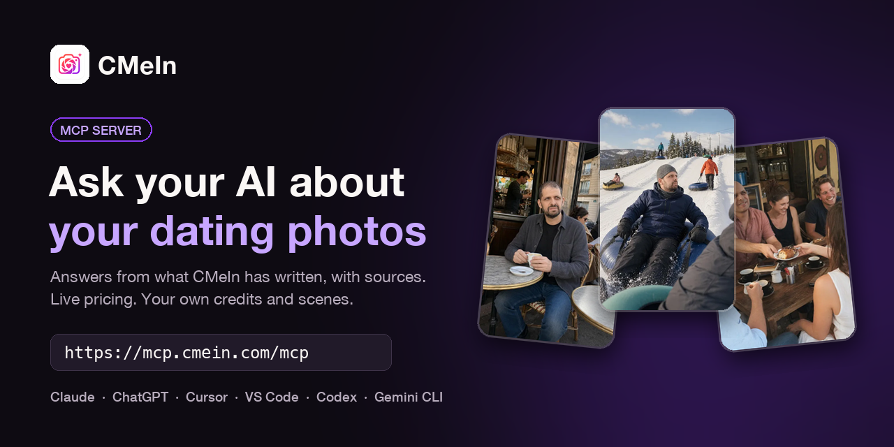

<p align="center">
  
</p>

<p align="center">
  <a href="https://cursor.com/install-mcp?name=cmein&config=eyJ1cmwiOiJodHRwczovL21jcC5jbWVpbi5jb20vbWNwIn0%3D"></a>
  <a href="https://insiders.vscode.dev/redirect/mcp/install?name=cmein&config=%7B%22type%22%3A%22http%22%2C%22url%22%3A%22https%3A%2F%2Fmcp.cmein.com%2Fmcp%22%7D"></a>
</p>

<p align="center">
  <a href="https://github.com/BarakBurger/cmein-mcp/actions/workflows/build.yml"></a>
  <a href="https://github.com/BarakBurger/cmein-mcp/releases"></a>
  <a href="LICENSE"></a>
</p>

# CMeIn MCP server

Connect [CMeIn](https://cmein.com) to your AI assistant. Ask about dating-profile photos and get
answers from what CMeIn has actually written, with the source links. Connect your account and your
assistant can check your credits, see what you have made, and find the next scene to shoot.

CMeIn turns a handful of ordinary phone photos of you into realistic, candid photos of you out in
the world: at a cafe, on a hike, at a friend's dinner. No studio headshots, no beauty filter.

## Quick start

There is nothing to install or run. CMeIn hosts the server; you add one address to your assistant:

```text
https://mcp.cmein.com/mcp
```

| Assistant | How |
|---|---|
| **Claude** (web, desktop) | Open Connectors, choose **Add custom connector**, paste the address. Free plans allow one custom connector. |
| **Claude Code** | `claude mcp add --transport http cmein https://mcp.cmein.com/mcp` |
| **ChatGPT** | Plugins, **Add**, **Create MCP App**, paste the address |
| **Cursor** | The **Add to Cursor** button above, or add it to `~/.cursor/mcp.json` (below) |
| **VS Code** | The **Install in VS Code** button above, or `code --add-mcp '{"name":"cmein","type":"http","url":"https://mcp.cmein.com/mcp"}'` |
| **Codex, Grok, Gemini CLI** | Add an HTTP MCP server with the address above |

Cursor's `~/.cursor/mcp.json`:

```json
{
  "mcpServers": {
    "cmein": { "url": "https://mcp.cmein.com/mcp" }
  }
}
```

Then ask it something:

- *"Are AI dating photos catfishing?"*
- *"What does CMeIn cost?"*
- *"Find me a CMeIn scene in a cafe"* (asks you to sign in to CMeIn once)

The six public tools work straight away. The four account tools ask you to sign in to CMeIn once,
on one approval screen that lists exactly what you are granting.

## See it work

A real exchange in Claude Code, 2 November 2026, with the connector added:

> **You:** Are AI dating photos with cmein catfishing?
>
> *Claude called `photo_advice` on cmein*
>
> **Claude:** No, not if they're used the way CMeIn is built for. CMeIn works from a handful of your
> own ordinary phone photos. It changes where you are and what you're doing, and it's designed to
> keep your real face and build. Its own line is "the real, ordinary you, preserved": no younger
> look, no slimmer body, no sharper jaw. In the article's words: "The scenery changes; the guy does
> not."
>
> The test from CMeIn's article
> ([Are AI Dating Photos Catfishing?](https://cmein.com/blog/are-ai-dating-photos-catfishing)) is:
> **would your date recognise you instantly, with no disappointment?** CMeIn photos are made to pass
> that test.
>
> The tool can't make the photos honest for you, though. Two things are still up to you:
>
> - **Pick scenes that are true to your life.** A surf photo when you've never surfed is still a
>   broken promise, whoever made it.
> - **Don't post a result that doesn't look like you.** If one comes out looking unlike you, leave
>   it out.
>
> Note: this is CMeIn's own description of its product, not an independent review.

The answer comes from CMeIn's own article, and the link is there so you can check it.

## Tools

### No account needed

| Tool | Ask it | What it does |
|---|---|---|
| `photo_advice` | "Are AI dating photos catfishing?" | Answers from CMeIn's [published articles](https://cmein.com/blog), with the passages and their links |
| `cmein_pricing` | "What does CMeIn cost?" | Reads the live [pricing page](https://cmein.com/pricing), so the figure is current |
| `see_examples` | "Show me what the photos look like" | Points at the [examples gallery](https://cmein.com/examples) and where new work is posted |
| `find_video` | "Is there a CMeIn film about who pays on a first date?" | Finds the short on [YouTube](https://www.youtube.com/@cmein-ai/shorts) and links it |
| `cmein_info` | "What is the refund policy?" | Reads the policy page itself: [FAQ](https://cmein.com/faq), [refunds](https://cmein.com/refund-policy), [terms](https://cmein.com/terms), [privacy](https://cmein.com/privacy) and more |
| `contact_us` | "Ask CMeIn whether my photos would work" | Sends a message to a real person, who replies by email |

### With your CMeIn account

One approval screen on cmein.com lists exactly what you are granting.

| Tool | Ask it | Scope |
|---|---|---|
| `my_credits` | "How many CMeIn credits do I have?" | `credits:read` |
| `my_generations` | "What have I generated lately?" | `photos:read` |
| `find_scene` | "Find me a CMeIn scene in a cafe" | `scenes:read`, searches over 4,500 scenes |
| `request_credits_back` | "Ask CMeIn for credits back, it does not look like me" | `support:write`, opens a request a person answers |

### What it does not do

- **It does not generate photos.** That happens in the [app](https://cmein.com).
- **Your photographs never pass through it.** "What have I made" answers with scenes and dates, not
  images. Routing your pictures through another company's chat logs buys you nothing.
- **It cannot spend your credits.** There is no write scope for photos, by design.

## Tool reference

<details>
<summary>Parameters and limits for all ten tools</summary>

Read from the live server's `tools/list`. Read-only tools change nothing; the two that write send a
message to a person at CMeIn and nothing else.

| Tool | Parameters | Read-only |
|---|---|---|
| `photo_advice` | `question` string, required, up to 500 chars; `limit` 1 to 5, default 3 | yes |
| `cmein_pricing` | none | yes |
| `see_examples` | none | yes |
| `find_video` | `about` string, up to 300 chars, empty for the newest; `limit` 1 to 5, default 3 | yes |
| `cmein_info` | `topic`, required: `pricing`, `examples`, `faq`, `about`, `refund`, `careers`, `guides`, `terms`, `privacy` | yes |
| `contact_us` | `email`, `subject`, `message` required (255, 200, 5000 chars); `name` optional | no, sends a message |
| `my_credits` | none | yes |
| `my_generations` | `limit` 1 to 25, default 10 | yes |
| `find_scene` | `q` place, activity or setting, up to 80 chars; `limit` 1 to 40, default 12 | yes |
| `request_credits_back` | `reason` required, up to 5000 chars; `generationId` optional, from `my_generations` | no, opens a request |

Ask your assistant to list the tools to see the exact schemas it received.

</details>

## How it works

- **Advice** is BM25 search over CMeIn's own articles, with the title and target keyword weighted.
  It returns passages and links, not a summary, so the assistant can quote and you can check.
- **Prices, policies and pages** are fetched live from cmein.com through a fixed allow-list of
  paths. Nothing is answered from memory.
- **Account tools** are thin calls to cmein.com's API carrying your own access token. This server is
  an OAuth resource server only: it holds no secrets, mints no tokens, and verifies each token
  against cmein.com's published signing keys, checking the issuer and that the token was issued for
  this server (RFC 8707). Credits, terms and limits are enforced by cmein.com, not here.

## Self-hosting (optional)

You do not need this to use CMeIn; the hosted address above is the normal way. To run your own
copy, Node 22 or newer:

```bash
npm install
npm run build
node dist/index.js
```

It listens on port 8000 and syncs the articles on boot. `GET /health` answers 503 until the article
index is built, then 200.

| Env | Default | |
|---|---|---|
| `PORT` | `8000` | |
| `CMEIN_ORIGIN` | `https://cmein.com` | where articles, pages and the account API come from |
| `MCP_RESOURCE` | `https://mcp.cmein.com/mcp` | the audience a token must carry |
| `BLOG_SYNC_MINUTES` | `60` | how often the article copy refreshes |
| `PAGE_CACHE_MINUTES` | `30` | how long a fetched page is reused |
| `VIDEO_SYNC_MINUTES` | `180` | how often the video feed refreshes |

A self-hosted copy serves the public tools fine. The account tools are meant for the hosted
address: CMeIn issues tokens for `https://mcp.cmein.com/mcp` only.

A `Dockerfile` is included: a two-stage build that runs as a non-root user with a health check.

## Links

### Use CMeIn

- [cmein.com](https://cmein.com) on the web, or the app on the
  [App Store](https://apps.apple.com/app/id6777321629) and
  [Google Play](https://play.google.com/store/apps/details?id=com.cmein.ai)
- [Pricing](https://cmein.com/pricing): the credit packs. `cmein_pricing` reads this page live, so
  no price is copied into this repo.
- [The Wingman](https://cmein.com/wingman): photos, a bio and your messages, worked on with you
- [Best Angle](https://cmein.com/best-angle): a free tool that ranks your photos and names the one
  to lead with

### Where the answers come from

- [Blog](https://cmein.com/blog) and [Guides](https://cmein.com/guides): what `photo_advice` searches
- [YouTube shorts](https://www.youtube.com/@cmein-ai/shorts): what `find_video` finds

### This connector

- [cmein.com/mcp](https://cmein.com/mcp): the same connector explained for people, not developers
- A question or a bug: [open an issue](https://github.com/BarakBurger/cmein-mcp/issues), or ask the
  connector itself with `contact_us`

### Follow CMeIn

[Instagram](https://www.instagram.com/cmein.app/) ·
[Threads](https://www.threads.com/@cmein.app) ·
[Facebook](https://www.facebook.com/people/CMeIn/61590427634614/) ·
[YouTube](https://www.youtube.com/@cmein-ai/shorts)

## License

[MIT](LICENSE)
